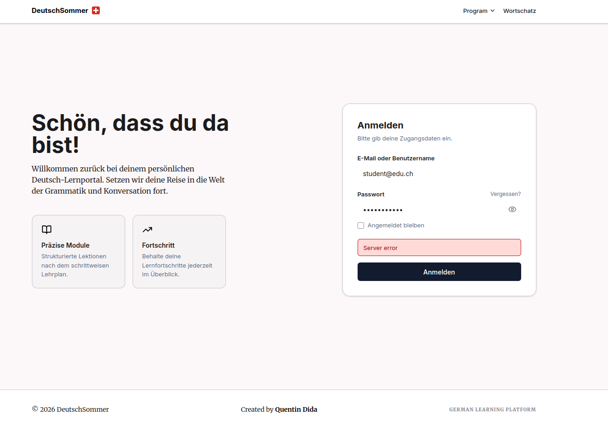
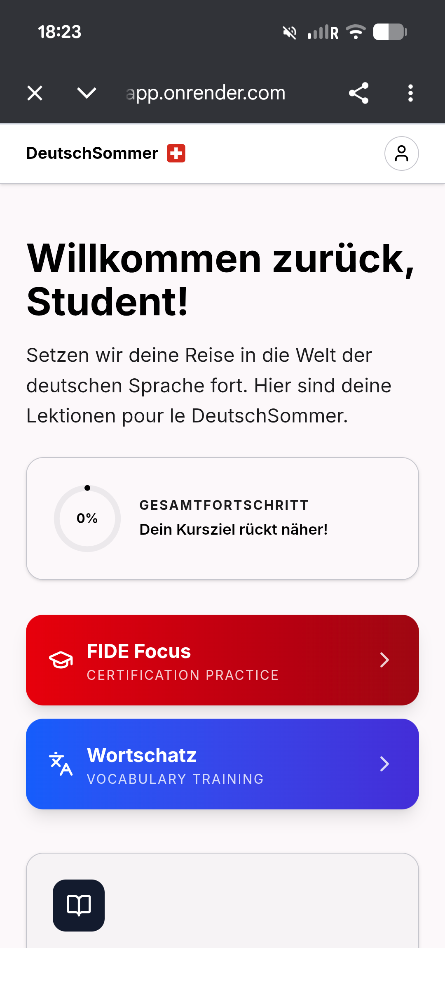
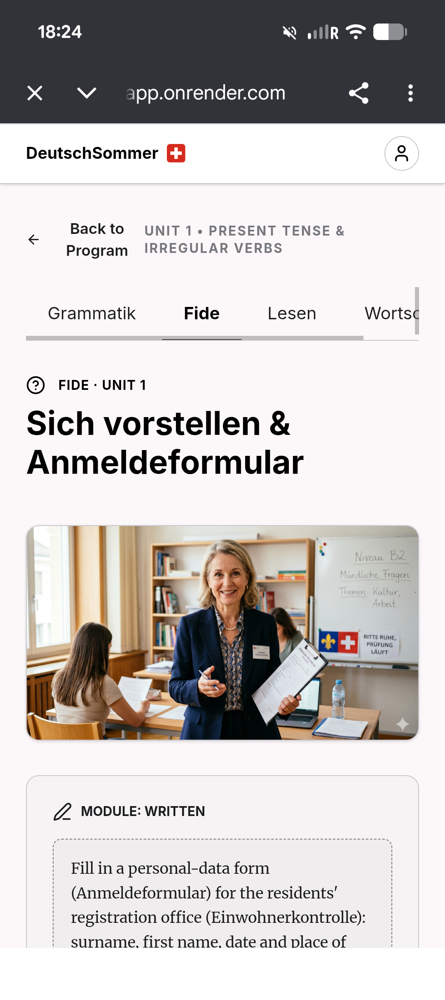
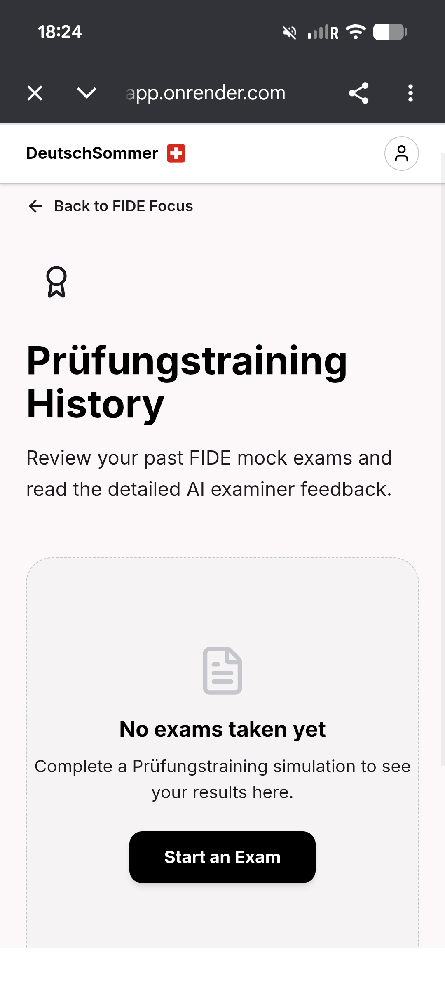
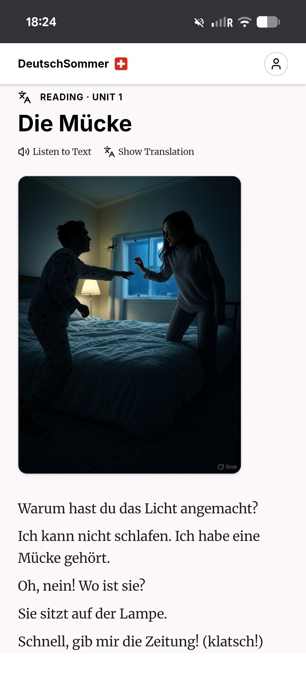
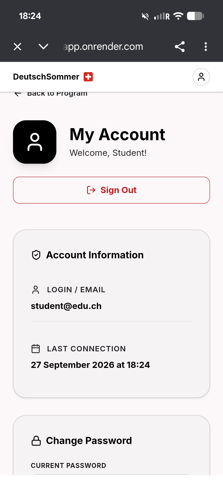

# Avant / Après : les 6 vues de DeutschSommer

Pour chaque capture du dossier `assets/img/`, la colonne **Avant** décrit ce qu'on voit aujourd'hui, la colonne **Après** décrit la vue corrigée. Les numéros `[#n]` renvoient aux points de [audit-deutschsommer.md](audit-deutschsommer.md).

Les textes « Après » sont des propositions en français (langue d'interface recommandée, [#7]) et le nom « FIDE Coach » est un exemple provisoire ([#1]).

---

## 1. Page de connexion (desktop)



| | Avant | Après |
|---|---|---|
| **Rôle de la page** | Écran de connexion unique qui sert aussi d'accueil public | Deux pages distinctes : **landing publique** (créer un compte) et **connexion** simple [#6] |
| **Titre** | « Schön, dass du da bist! » + « Willkommen zurück… » (suppose que le visiteur est déjà inscrit) | « Réussissez l'examen fide A1-B1 » + sous-titre « Examens blancs, vocabulaire et correction IA de vos réponses » |
| **CTA** | Aucun lien « Créer un compte ». Seul « Anmelden » | CTA principal « Essayer gratuitement » ; « Se connecter » en lien secondaire dans l'en-tête |
| **Cartes** | « Präzise Module » et « Fortschritt », génériques | 3 bénéfices concrets : *Examen blanc complet (4 parties)*, *Correction détaillée par IA*, *Vocabulaire qui s'adapte à vous* |
| **Preuve** | Aucune | Capture réelle de l'app, exemple de correction, FAQ (« Est-ce officiel ? », « Mes données ? ») |
| **Erreur** | Bandeau rouge « Server error » en anglais | « Le serveur se réveille, réessayez dans quelques secondes » + bouton **Réessayer** et indicateur de chargement sur le bouton [#3] |
| **Menu** | « Program », « Wortschatz » visibles avant connexion | « Fonctionnalités · Tarifs · FAQ · Se connecter » |
| **Champs** | Libellés allemands, case « Angemeldet bleiben » petite | Libellés dans la langue choisie, cases et liens de 44×44 px minimum [#18] |
| **Pied de page** | « Created by… », « GERMAN LEARNING PLATFORM » en petites capitales grises | Mentions légales, confidentialité, contact, mention « Préparation indépendante, non affiliée à fide » |

```
Avant                                    Après
┌──────────────────────────────┐         ┌──────────────────────────────────────┐
│ DeutschSommer 🇨🇭  Program Wortschatz │         │ FIDE Coach        Fonctionnalités  FAQ  [Se connecter] │
│                              │         │                                      │
│ Schön, dass du da bist!      │         │ Réussissez l'examen fide A1-B1       │
│ Willkommen zurück…  ┌───────┐│         │ Examens blancs + correction IA       │
│ [Module] [Fortschritt]│Anmelden││        │ [ Essayer gratuitement ]  ┌────────┐ │
│                     │Server  ││         │ ✔ Examen blanc  ✔ Audio   │ capture│ │
│                     │error   ││         │ ✔ Vocabulaire   ✔ Suivi   │ de l'app│ │
└──────────────────────────────┘         └──────────────────────────────────────┘
```

---

## 2. Accueil (mobile)



| | Avant | Après |
|---|---|---|
| **Bienvenue** | « Willkommen zurück, Student! » (valeur par défaut) | « Bonjour Camille » (prénom demandé à l'inscription) [#5] |
| **Phrase d'intro** | « …Lektionen **pour le** DeutschSommer » (mélange allemand/français) | Phrase corrigée, ou supprimée au profit d'une information utile : « Examen dans 42 jours » [#2] |
| **Progression** | Anneau à 0 % + « Dein Kursziel rückt näher! » (message sans rapport) | Anneau avec objectif : « 0 / 12 leçons · Objectif A2 » ; message adapté : « Commencez votre première leçon » [#5, #9] |
| **Action principale** | Aucune : deux gros boutons de même poids | Carte en tête **« Ta prochaine leçon : Sich vorstellen · 10 min »** avec bouton « Commencer » [#8] |
| **Accès secondaires** | « FIDE Focus » (rouge) et « Wortschatz » (bleu), dégradés, sous-titres anglais | Deux cartes plus discrètes, couleur unique : « Examen blanc » et « Vocabulaire », sous-titres en français [#8, #20] |
| **Rouge dégradé** | Évoque une alerte ou une action destructive | Rouge réservé aux erreurs ; couleur principale de la marque pour les actions |
| **Navigation** | Un seul accès : l'icône de profil | Barre fixe en bas : Accueil · Programme · Vocabulaire · Examen · Compte [#10] |
| **Navigateur** | Adresse `onrender.com` visible | Nom de domaine propre (`.ch`) [#21] |

```
Avant                         Après
┌──────────────────┐          ┌──────────────────┐
│ DeutschSommer  👤│          │ FIDE Coach     👤│
│ Willkommen zurück│          │ Bonjour Camille  │
│ Student!         │          │ Examen dans 42 j │
│ …pour le Deutsch…│          │ ┌──────────────┐ │
│ (0%) Kursziel…   │          │ │ ◔ 0/12  A2   │ │
│ [ FIDE Focus  >] │          │ │ Prochaine leçon│
│ [ Wortschatz  >] │          │ │ Sich vorstellen│
│                  │          │ │ 10 min [Commencer]│
│                  │          │ └──────────────┘ │
│                  │          │ [Examen] [Vocab.]│
│                  │          │ 🏠 📖 🔤 📝 👤   │
└──────────────────┘          └──────────────────┘
```

---

## 3. Leçon FIDE, unité 1 (mobile)



| | Avant | Après |
|---|---|---|
| **Retour** | « Back to Program » sur deux lignes, en anglais | « ← Programme » sur une ligne [#2, #10] |
| **Titre d'unité** | « UNIT 1 • PRESENT TENSE & IRREGULAR VERBS » (anglais, capitales espacées) | « Unité 1 · Présent et verbes irréguliers » + étape « 1/4 » |
| **Onglets** | Grammatik · Fide · Lesen · « Wortsc… » coupé, défilement non signalé | Onglets entièrement visibles (icônes + libellés courts) ou défilement signalé par un dégradé de bord [#10] |
| **Étiquette** | « FIDE · UNIT 1 » | « FIDE · Unité 1 » ; « FIDE » écrit de la même façon partout (l'onglet affiche « Fide ») |
| **Image** | Grande illustration (plus d'un tiers d'écran) ; tableau marqué « Niveau B2 » alors que l'unité est de niveau débutant [#5, #11] | Image réduite (16:9), niveau cohérent, filigrane retiré, texte alternatif ajouté [#4] |
| **Consigne** | En anglais, longue, dans un cadre pointillé en serif, sous la ligne de flottaison | Consigne courte en français (« Remplis le formulaire d'inscription »), visible dès l'arrivée ; détail dans un bloc repliable [#7, #11] |
| **Durée / objectif** | Absents | « 10 min · Compétence : Schreiben » |
| **Action** | Non visible | Bouton « Commencer l'exercice » en bas, fixe |

---

## 4. Historique des examens (mobile)



| | Avant | Après |
|---|---|---|
| **Titre** | « Prüfungstraining History » (allemand + anglais) | « Historique des examens blancs » [#2] |
| **En-tête** | Grande icône de médaille qui occupe la moitié de l'écran avant le contenu | Icône supprimée ou réduite ; titre et état vide visibles sans défilement |
| **Introduction** | « Review your past FIDE mock exams and read the detailed AI examiner feedback. » (anglais) | « Retrouvez vos examens blancs et le retour détaillé de la correction IA. » |
| **État vide** | Bon principe : icône + « No exams taken yet » + bouton « Start an Exam » | **À conserver**, traduit : « Aucun examen passé » · « Passez un examen blanc pour voir vos résultats ici » · bouton « Commencer un examen » (durée indiquée : « 2 h environ ») |
| **Prérequis** | Non indiqués | Conseil : « Avez-vous terminé les unités 1 à 3 ? Voir mon niveau » |
| **Quand il y aura des examens** | Non visible | Liste : date, niveau estimé (« A2 estimé »), score par partie (Sprechen / Hören / Lesen / Schreiben), évolution entre essais, retour détaillé repliable [#16] |
| **Mention IA** | Absente | « Estimation indicative, ce n'est pas un résultat officiel fide » [#13] |

---

## 5. Texte de lecture « Die Mücke » (mobile)



| | Avant | Après |
|---|---|---|
| **Étiquette** | « READING · UNIT 1 » (anglais) | « Lecture · Unité 1 · A1 » |
| **Actions audio** | Liens « Listen to Text » et « Show Translation » petits, en serif, peu visibles | **Lecteur audio visible** : bouton lecture large, vitesse 0,75× / 1×, barre de progression, surlignage de la phrase lue [#12] |
| **Traduction** | Un seul bouton global | Traduction phrase par phrase au toucher, plus option « traduction complète » |
| **Image** | Pleine hauteur, plus étroite que le texte, filigrane « Grok » visible, repousse le texte sous l'écran | Image 16:9, pleine largeur, sans filigrane, texte alternatif [#4, #11] |
| **Dialogue** | Répliques sans interlocuteur : « Warum hast du das Licht angemacht ? » | Répliques attribuées (Anna / Tom) ou avec bulles alternées pour savoir qui parle [#12] |
| **Vocabulaire** | Aucun mot cliquable | Mots clés soulignés (*Mücke*, *Zeitung*) avec définition au toucher et bouton « Ajouter à mon vocabulaire » |
| **Typographie** | Texte en serif, taille correcte | Serif conservée pour le texte à étudier ; interface (boutons, liens) en sans-serif [#19] |
| **Fin de texte** | Non visible | Mini quiz de compréhension (3 questions), puis bouton « Unité suivante » |
| **Navigation** | Aucun retour visible | « ← Unité 1 » en haut |

---

## 6. Mon compte (mobile)



| | Avant | Après |
|---|---|---|
| **En-tête** | Avatar noir massif + « Welcome, Student! » (anglais) | Avatar réduit avec initiales ; « Bonjour Camille » |
| **Retour** | Lien « Back to Program » partiellement masqué sous l'en-tête fixe | « ← Programme » entièrement visible, marge sous l'en-tête corrigée [#17] |
| **Déconnexion** | Bouton rouge **en haut**, très visible, avant les informations (risque de déconnexion accidentelle) | Déplacé **en bas de page**, style secondaire, avec confirmation |
| **Informations** | « LOGIN / EMAIL » et « LAST CONNECTION » en anglais ; date « 27 September 2026 at 18:24 » | « E-mail » et « Dernière connexion » ; date au format de la langue (« 27 sept. 2026, 18 h 24 ») [#17] |
| **Profil d'apprentissage** | Absent | Nouvelle section : objectif (niveau A2), date d'examen, temps quotidien, modifiables [#9] |
| **Rappels** | Absents | Section « Rappels » : e-mail ou notification, jours et heure [#14] |
| **Mot de passe** | « Change Password », « CURRENT PASSWORD » en capitales espacées grises | Libellés en casse normale, contraste renforcé, bouton œil pour afficher le mot de passe [#18] |
| **Données** | Absentes | « Exporter mes données » et « Supprimer mon compte » en bas, avec lien vers la politique de confidentialité [#13, #17] |

---

## Résumé des changements transversaux

| Thème | Avant | Après |
|---|---|---|
| Langue | Allemand, anglais et français mélangés | Interface dans une seule langue (français), allemand réservé au contenu à apprendre |
| Nom | « DeutschSommer » | Nom lié à l'examen (exemple : « FIDE Coach ») |
| Navigation mobile | Icône de profil uniquement | Barre fixe en bas à 5 entrées |
| Action principale | Deux boutons de même poids | Une seule « prochaine action » par écran |
| Images | Filigrane visible, incohérences de niveau, trop hautes | Retouchées, 16:9, texte alternatif |
| Typographie | Serif et sans-serif mélangées sur les contrôles | Règle fixe : serif pour lire, sans-serif pour agir |
| Couleurs | Dégradés rouge et bleu concurrents | Une couleur de marque, rouge réservé aux erreurs |
| Erreurs | « Server error » brut | Message humain avec bouton « Réessayer » |
